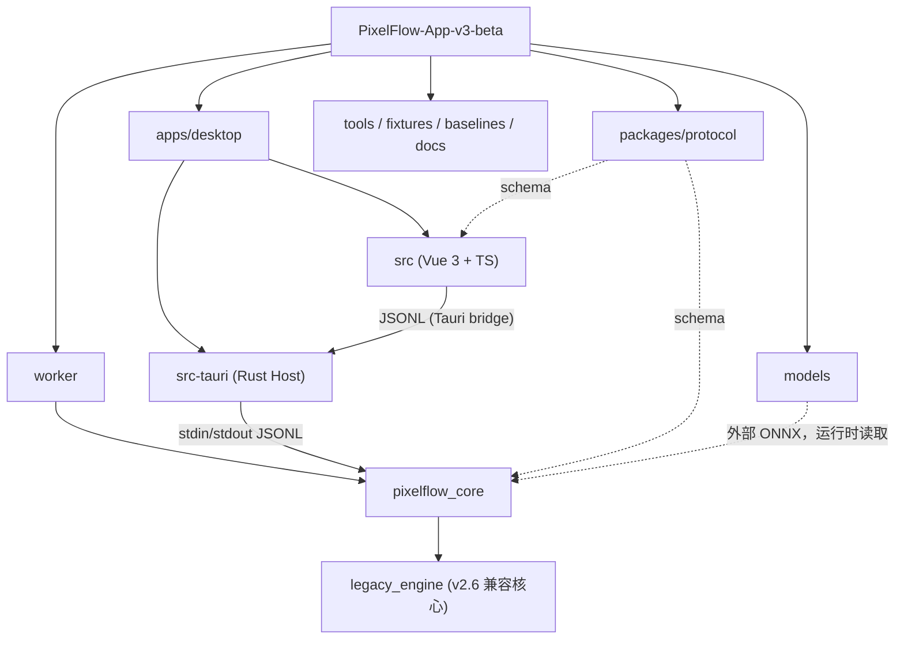

# PixelFlow v3 beta

## 变更记录 (Changelog)

- 2026-10-02：初始化 AI 上下文文档（根 + apps/desktop、worker、packages/protocol、models 模块文档）。

## 项目简介

PixelFlow v3 beta 是 macOS 桌面应用（Tauri 2 + Vue 3 宿主，位于 `apps/desktop`），把电商商品图 / 模特图批量生成指定尺寸的主图（1440x1440、1125x1500、1440x1920、VIP 1440）。图像处理由 Python Worker（`worker/`，PyInstaller onedir 打包并随 App 分发）完成：素材分类 + 渲染。宿主与 Worker 通过 JSONL 协议通信（`packages/protocol/schema.json`、`apps/desktop/src/workerProtocol.ts`）。

模特图使用按品类的“锚点构图”（shirt、shoes、long_pants/pants、shorts、socks、hat、gloves、knee_pads、bag），依赖外部 ONNX 模型（pose / segmentation / detection），不足的左右宽度由 `worker/pixelflow_core/side_fill.py` 合成背景补边。版本 `3.0.0-beta.1`。

## 模块结构图



## 模块索引

| 模块 | 路径 | 职责 | 文档 |
|---|---|---|---|
| 桌面端 | `apps/desktop` | Vue UI + Tauri Rust Host（拉起/监督 Worker、文件对话框、诊断包） | [CLAUDE.md](apps/desktop/CLAUDE.md) |
| Worker | `worker` | `pixelflow_core`：分类、构图、渲染、模型服务、缓存；PyInstaller 打包 | [CLAUDE.md](worker/CLAUDE.md) |
| 协议 | `packages/protocol` | Worker 消息信封 JSON Schema | [CLAUDE.md](packages/protocol/CLAUDE.md) |
| 模型 | `models` | 外部 ONNX 模型目录说明与 YOLO-World 导出脚本（模型二进制不入 Git） | [CLAUDE.md](models/CLAUDE.md) |
| 工具 | `tools` | `check_protocol_schema.py`、`run_acceptance.py`、`run_renderer_baseline.py`、`verify_output_baseline.py` | 无单独文档 |
| 固定素材 | `fixtures` | `manifest.json`、`model-manifest.json`、`shoe-matrix.json`（只引用外部素材，不复制图片） | 见 `fixtures/README.md` |
| 基线 | `baselines` | v2.6 输出基线 JSON（图片本地忽略） | 见 `baselines/README.md` |
| 文档 | `docs` | 架构、协议、状态、各阶段方案与验收（中文） | `docs/STATUS.md`、`docs/architecture.md`、`docs/worker-protocol.md` |
| CI | `.github/workflows/v3.yml` | worker 测试（macos-14 / windows-2022，Python 3.12）；desktop（npm ci、protocol:check、build、cargo check） | - |
| 规划 | `.planning` | GSD 规划记录（仅提及，不展开） | - |

`worker/pixelflow_core/legacy_engine` 是从 v2.6 复制的兼容图像核心（离线运行用），内部不在文档范围内。

## 构建 / 测试 / 打包命令

```bash
# Worker 单元测试（与 CI 一致）
PYTHONPATH=worker python -m unittest discover -s worker/tests -p 'test_*.py'

# 协议 schema 检查 + 前端构建
cd apps/desktop && npm ci && npm run protocol:check && npm run build

# Rust Host 检查（CI 里需先 mkdir -p worker/dist-ondir/pixelflow-worker）
cd apps/desktop/src-tauri && cargo check

# 构建 Worker（优先 PIXELFLOW_PYTHON，其次 worker/.venv/bin/python；缺少两者时明确失败）
./tools/build_worker.sh

# Tauri 打包（beforeBuildCommand 会先 worker:build 再前端 build）
cd apps/desktop && npm run tauri:build  # worker:build 通过 tools/build_worker.sh 固定解释器
```

详见 [worker/CLAUDE.md](worker/CLAUDE.md) 与 [apps/desktop/CLAUDE.md](apps/desktop/CLAUDE.md)。

## 关键约定与注意事项

1. **规则版本必须四处同步**：字符串 `v3-composition-10` 同时出现在
   - `worker/pixelflow_core/worker.py`（`RULES_VERSION`，ready 事件的 `rules_version`）
   - `worker/pixelflow_core/model_cache.py`（`COMPOSITION_RULES_VERSION`，进入缓存 identity）
   - `apps/desktop/src/App.vue`（`expectedRulesVersion`，不一致时前端提示 Worker 规则版本不匹配）
   - `worker/tests/test_shoe_composition.py`（断言 evidence 中的版本）
   修改构图规则后四处同改，否则旧缓存会被复用或前端报版本不匹配。（`docs/STATUS.md` 里仍写 `v3-composition-1`，已过期。）
2. **不得在没有回归的情况下改变 shirt / shoes / pants 的既有行为**；新增品类（socks、hat、gloves、knee_pads、bag 等）不得影响它们。
3. **渲染结果必须以 100% 缩放目视检查**，尤其是 side fill（合成补边）的接缝与纹理。
4. **`/tmp` 在 Finder 中不可见**：给用户看的图片放到 `~/Desktop/PixelFlow/05_测试素材与输出/`。
5. **测试 App 时务必“强制重跑”**：v3 同名输出默认复用，只有显式 `force_rerender` 才覆盖。
6. **打包**：用 `ditto` 复制 `.app` 后必须重新 ad-hoc 签名：`codesign --force --deep --sign - <app>`，再 `codesign --verify --deep --strict <app>`（见 `docs/v3-剩余品类锚点构图需求-2026-10-01.md`）。
7. **外部素材缺失时部分测试会 skip**（`test_classification.py`、`test_engine.py`、`test_shoe_composition.py`、`test_worker_process.py`）；”全绿”不代表这些路径被覆盖。
8. 模型文件（pose / seg / detection）不入 Git、不打包进 App，通过设置页指定目录；缺失时 Worker 回退到规则判断。
9. 构建产物目录（`dist*`、`build*`、`worker/.pyinstaller-config*`、`target`）不要阅读或修改。
10. **Pillow API**：已迁移到 `get_flattened_data()`（替代弃用的 `getdata()`），影响 `renderer.py`、`v3_classification.py`、`legacy_engine/category_engine/source_type_classifier.py`。

## 当前状态入口

`docs/STATUS.md`（更新日期 2026-09-27，部分条目已落后于代码，如规则版本）；锚点构图最新方案/验收见 `docs/v3-*锚点构图*.md`。
